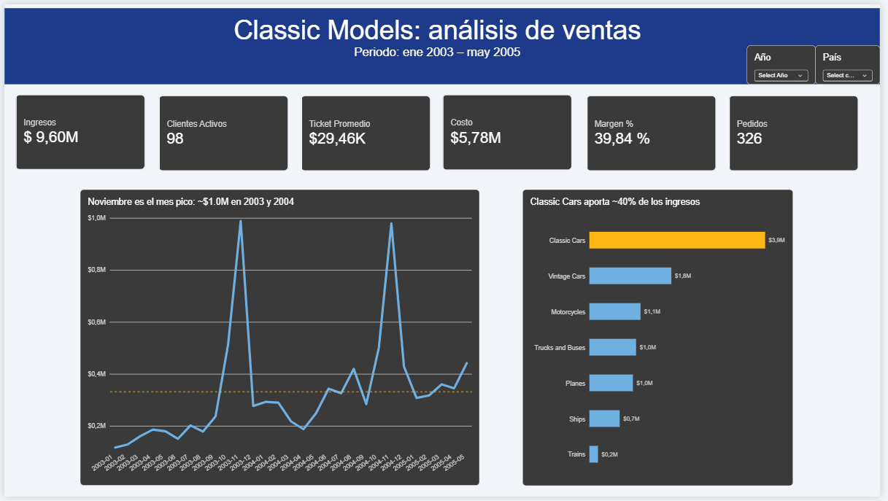

# Análisis de ventas de Classic Models con SQL y Power BI

Proyecto de análisis de datos de punta a punta sobre la base de datos de ejemplo **Classic Models** (una distribuidora de modelos a escala): exploración y limpieza con **MySQL**, y presentación de los hallazgos en un dashboard de **Power BI**.




## Objetivo

Responder preguntas de negocio sobre ingresos, clientes, productos y operación, y comunicar los resultados de forma clara.

## Herramientas

- **MySQL / MySQL Workbench:** exploración, limpieza y análisis (JOINs, subconsultas, CTEs, window functions).
- **Power BI:** modelo de datos, medidas DAX y dashboard interactivo.

## Los datos

Base de datos de ejemplo **Classic Models** (8 tablas: clientes, pedidos, detalle de pedidos, productos, líneas de producto, pagos, empleados y oficinas).

Cómo reproducirlo:

1. Descarga el script de la base de datos desde [mysqltutorial.org](https://www.mysqltutorial.org/) (sección *MySQL Sample Database*).
2. Ejecútalo en MySQL Workbench (*File → Run SQL Script*).
3. Ejecuta `sql/classicmodels_consultas.sql` para ver las consultas del análisis.

> El script de la base de datos no se incluye en este repositorio; se enlaza a su fuente original.

## Calidad de datos

Al agrupar clientes por país, **Noruega aparecía duplicada**. La causa: algunos registros tenían espacios sobrantes al final del texto (`"Norway  "` tiene 8 caracteres frente a 6 de `"Norway"`), por lo que SQL los trataba como países distintos.

- **En SQL:** se corrigió con `TRIM(country)` en las consultas que agrupan por país.
- **En Power BI:** se aplicó *Trim* en Power Query antes de cargar los datos.

## Preguntas de negocio y hallazgos

| Pregunta | Hallazgo |
|---|---|
| ¿Qué líneas de producto generan más ingresos? | Classic Cars aporta ~40% de los ingresos (3.85M de 9.60M). Con Vintage Cars (18.7%) y Motorcycles (11.7%) suman ~70.5%. Trains es la más pequeña (~2%). |
| ¿Qué tan concentrados están los ingresos en los clientes? | Euro+ Shopping Channel aporta 8.55% y Mini Gifts Distributors 6.16%. Los 10 mejores clientes suman ~27.9%. |
| ¿Hay clientes que nunca han comprado? | Sí: 24 de 122 clientes (~20%) no tienen ningún pedido. |
| ¿Cómo evolucionan las ventas en el tiempo? | Los pagos crecieron ~32.7% de 2003 a 2004 y hay una fuerte estacionalidad: noviembre y diciembre concentran ~47% de los pagos de 2003 y ~39% de 2004. |
| ¿Se cumplen las fechas de entrega? | Solo 1 de 312 pedidos enviados llegó tarde (0.32%): el pedido 10165, con 56 días de retraso. |
| ¿Cuáles son los productos más vendidos por línea? | La 1992 Ferrari 360 Spider red lidera el catálogo con 1,808 unidades. |
| ¿Cada cuánto vuelven a comprar los clientes? | En promedio cada ~211 días (mediana 224). Los clientes más grandes compran mucho más seguido: Euro+ cada ~34 días y Mini Gifts cada ~50. |
| ¿Qué carga tiene cada representante de ventas? | Cada representante atiende entre 5 y 10 clientes. 22 de los 122 clientes no tienen representante asignado. |

Las consultas completas, comentadas por pregunta, están en [`ClassicModels/Consultas_ClassicModels.sql`](ClassicModels/Consultas_ClassicModels.sql).

## Dashboard

<!-- Agrega aquí tus capturas de cada página -->


El dashboard incluye tarjetas de resumen (ingresos, pedidos, clientes activos, ticket promedio, costo y margen), la evolución mensual de ingresos y los ingresos por línea de producto.

Los totales del dashboard se validaron contra los resultados de SQL: ingresos de 9.60M, 326 pedidos y 98 clientes activos.

## Limitaciones y notas

- **Pagos vs. pedidos:** el análisis de tendencia en SQL usa la tabla de pagos (8.85M), y los ingresos del dashboard se calculan sobre pedidos (9.60M). La diferencia puede deberse a pedidos cancelados, retenidos o aún sin pagar.
- **Mes incompleto:** el último mes de datos (junio de 2005) está incompleto, por lo que su caída no refleja una baja real.
- **Límite de crédito:** la comparación contra el límite de crédito usa el total histórico comprado, no el saldo pendiente, así que no equivale a "clientes en mora".
- **Entregas tardías:** al ser un único caso, podría tratarse de una anomalía en los datos.
- **Estados de pedido:** los totales incluyen pedidos de todos los estados (también cancelados y en espera).

## Estructura del repositorio

```
├── README.md
├── sql/
│   └── classicmodels_consultas.sql
├── images/
│   └── (capturas del dashboard)
└── dashboard/
    └── classicmodels.pbix
```

## Autor

**Edwin Mejía** · [LinkedIn]((https://www.linkedin.com/in/edwin-andres-mejia-marin-6a3646368/)) · [edwinandresmejiamarin@gmail.com]· [edwin.mejia@utp.edu.co]
